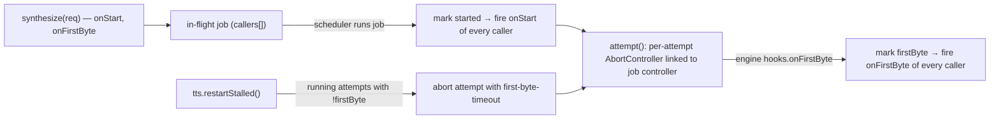

# Design — phase hooks and restartStalled

## Where it sits

## Phase hooks

- The in-flight record keeps `started` / `firstByte` flags and a list of per-caller hooks.
- A caller joining a flight whose phase already passed gets that hook called synchronously (after
  `synthesize` returns its promise, via a microtask, so the caller's own state is set).
- A cache hit (`ready`) calls both hooks immediately — the caller sees zero queue and first-byte time.
- Hooks fire once per caller per flight, on the first attempt that reaches the phase; a retry does
  not re-fire them. A throwing hook is swallowed (it must not fail the synthesis).
- An aborted caller's hooks are removed with it.

## Engine hook

`Engine.synthesize(text, voice, signal, hooks?)`, `hooks?.onFirstByte` called once per attempt, on
the first audio chunk. Edge direct: in the binary-frame handler where the first-byte deadline is
disarmed. Relay client: on the first body chunk. Engines that ignore `hooks` stay valid (phases then
report only `onStart`).

## restartStalled

- Each running attempt registers `{ controller, firstByte: false }` in a set on the instance; the
  attempt's controller is linked to the job controller (job abort aborts the attempt).
- `restartStalled()` walks the set; for each attempt with `firstByte === false` it aborts the
  attempt controller with reason `new TtsError("first-byte-timeout")` and returns `true` if any.
- `attempt()` treats an engine rejection while its own controller was aborted with a `TtsError`
  reason as that error (transient → retried if budget remains, else final). An abort of the *job*
  controller still surfaces as `AbortError`.
- The Edge engine already closes its socket on `signal` abort, so the abandoned socket is released
  (an improvement over motyl's old client, which could not close it).

## Testing

Unit tests in `src/__tests__/tts.test.ts` with a fake engine: hook order and once-only; late joiner
gets passed phases; cache hit fires both; retry does not re-fire; `restartStalled` → retry starts,
returns true; already-streaming → false; restart of the last attempt → final `first-byte-timeout`;
job abort during a restart still yields `AbortError`. Edge engine + relay client: `onFirstByte`
called once on the first chunk.
