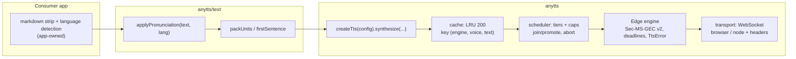
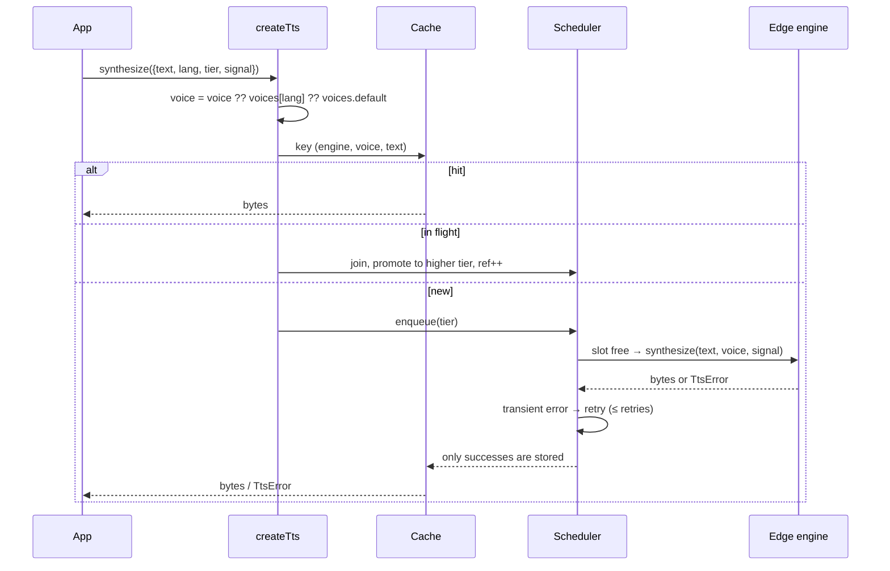
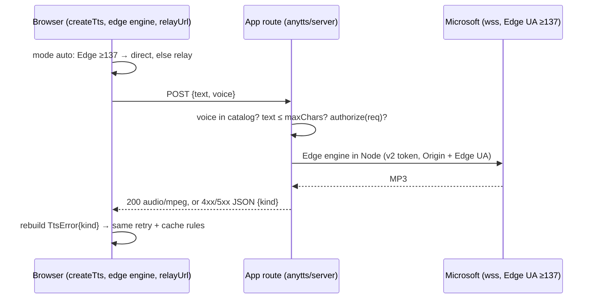

# Design: anytts v1

Grilled 2026-10-14 (log: `projects/pavilio/progress/2026-10-14-shared-tts-library-grill.md` in the
private workspace). Glossary: workspace `projects/anytts/CONTEXT.md` — **Engine**, **Voice**,
**Voice map**, **Forced language**, **Pronunciation map**.

**Name (2026-10-15):** published as `anytts`, not `free-tts`. The library is one TTS API over
interchangeable engines; paid engines (API key) may become engines later, so "free" describes the
current engines, not the library. Single-engine use stays the default; a multi-engine policy
(fallback, rotation) is a future change layered on top. The change id keeps its original name.

## Architecture



Three package entries: `anytts` (core), `anytts/text` (no engine code) and `anytts/server`
(the Relay handler, Node/edge-runtime only).
Pure TypeScript, ESM-only, zero runtime dependencies. Node ≥ 22 (global `WebSocket` accepts
`{ headers }` — verified on 22.22: Origin, User-Agent and custom headers reach the server).

## Public API (core)

```ts
const tts = createTts({
  engines: {
    edge: {
      voices: { pl: "pl-PL-MarekNeural", en: "en-US-AndrewMultilingualNeural",
                default: "en-US-AndrewMultilingualNeural" },
      firstByteMs: 8000, stallMs: 8000, retries: 1,
      transport?: Transport,           // default: global WebSocket (+ headers in Node)
      now?: () => number,              // clock for the token; tests inject it
    },
  },
  defaultEngine: "edge",
  scheduler: { concurrency: 1, tiers: [{ name: "play" }, { name: "warm" }] },
  cache: { max: 200 },
});

tts.synthesize({ text, lang?, voice?, engine?, tier?, signal? })
  // → Promise<{ bytes: ArrayBuffer, mime: "audio/mpeg", engine, voice }>
tts.prefetch(req)            // synthesize, result ignored, failure swallowed
tts.isCached(req)            // resolved key present
tts.subscribe(listener)      // cache entry added/evicted
listEngines()                // [{ id, label, runtimes: ("browser"|"node")[] }]
listVoices(engineId)         // [{ id, label, locale, gender, multilingual }]
resolveVoice(tts, { engine, voice?, lang? })  // → { voice, fellBack }
```

`createTts` returns an instance; there is no module-global state.

## Voice resolution and forced language

Edge read-aloud accepts only `speak` / `voice` / `prosody`. A spike against the live endpoint
(Python edge-tts 7.3.1, 2026-10-14) showed: `<lang xml:lang>` in every position, `<p|s xml:lang>`,
`mstts:*` and `<break>` all return **no audio**; `xml:lang` attributes on `speak`/`voice` are
accepted but did not change auto-detection by ear. Therefore:

- A **Forced language** is implemented solely by the **Voice map**: `voice ?? voices[lang] ?? voices.default`.
- No `xml:lang` hint is sent (inaudible; it would only perturb output bytes).
- `synthesize` is strict: a `voice` not in the engine's catalog rejects
  `TtsError{kind: "unknown-voice"}` before any network work.
- `resolveVoice` is the lenient path for settings UIs: a saved voice that does not belong to the
  chosen engine falls back to `voices[lang]`, then `default`, and reports `fellBack: true`.

## Synthesis flow



## Scheduler

Tiers are ordered most-important first. Each tier may carry a `cap`: the maximum number of jobs
in flight **from that tier and every tier below it**. `concurrency` caps the total.
A freed slot goes to the highest tier with waiting work whose cap allows it.

| App | concurrency | tiers |
|---|---|---|
| pavilio | 3 | `run`, `warm` (cap 2), `preload` — speculative never takes the run's last slot |
| motyl | 1 | `play`, `warm` |

- **Join**: a request whose key is already queued or in flight shares that job; if its tier is
  higher, the job is **promoted** (keeps its age within the new tier).
- **Abort**: each caller's `signal` detaches that caller. A queued job with no callers left leaves the
  queue; an in-flight job with no callers left closes its socket. A detached caller rejects with
  `AbortError` (not a `TtsError`, never retried).

## Failure contract

| kind | meaning | retried |
|---|---|---|
| `rejected` | 401/403, or the server closed before any audio | no (see clock skew) |
| `first-byte-timeout` | no audio within `firstByteMs` of sending the request | yes |
| `stalled` | gap between audio chunks exceeds `stallMs` | yes |
| `network` | socket error / unexpected close mid-audio | yes |
| `no-audio` | `turn.end` with zero audio bytes | no |
| `unknown-voice` | voice not in the engine's catalog | no |

Every `synthesize` settles. Failures are never cached. **Clock skew:** on the first `rejected`,
the engine reads the response `Date` header, corrects its clock offset and retries once — the
same remedy rany2/edge-tts applies; a second `rejected` is final.

## Edge engine internals

- **Token module** `Sec-MS-GEC` v2: plain JS (the modified SHA256 cannot use `crypto.subtle`),
  ported from rany2/edge-tts 7.3.0; first written for the 403 hotfix and moved here unchanged.
  Pure function of (timestamp, constants) → string.
- **Transport** interface `{ open(url, headers) → socket-like }`. Browser: `new WebSocket(url)`
  (headers impossible). Node: `new WebSocket(url, { headers })` with the Edge extension Origin and a
  Microsoft Edge ≥ 137 User-Agent (`… Chrome/143.0.0.0 … Edg/143.0.0.0`).
- **User-Agent gate (found 2026-10-14, after the hotfixes):** the endpoint answers 403 to any
  handshake whose User-Agent is not Microsoft Edge ≥ 137 — Chrome, Firefox, Safari, older Edge and
  `node` are refused; Origin is irrelevant. A browser cannot set User-Agent on a WebSocket, so
  **direct browser synthesis works only inside Edge**. Everything else goes through the **Relay**.
- **Protocol**: `speech.config` (output `audio-24khz-48kbitrate-mono-mp3`) then `ssml`
  (`speak` > `voice` > `prosody`, text XML-escaped); binary frames carry audio after a header
  block; `Path:turn.end` ends the turn.

## Relay (server-side synthesis for non-Edge browsers)



- **Server** `anytts/server`: `createRelayHandler({ maxChars = 2000, authorize?, edge? })` returns a
  Fetch-standard `(Request) => Promise<Response>` (used as-is by a Next.js route handler) plus
  `toNodeHandler(handler)` for Express / `node:http`. Validation: unknown voice → `400 {kind:"unknown-voice"}`,
  text too long → `413`, `authorize` false → `403`, engine failure → `502 {kind}`. Stateless: cache
  and scheduler stay in the browser instance; rate limiting is the app's job.
- **Browser**: the `edge` engine takes `relayUrl` and `mode: "auto" | "direct" | "relay"`
  (default `auto` when `relayUrl` is set, `direct` otherwise). `auto` picks **direct** when
  `navigator.userAgent` is Edge ≥ 137 and **relay** otherwise; if a direct attempt in `auto` mode ends
  `rejected`, the engine switches to relay for the rest of the instance's life. In Node the engine is
  always direct. Engine id and voices are identical in both modes, so cache keys, settings and
  `resolveVoice` do not change.
- **Deadlines over HTTP**: `firstByteMs` runs until the response headers, `stallMs` between body
  chunks; a fetch error is `network`.

## anytts/text

- **Pronunciation maps** keyed by the **spoken language** of the voice: `applyPronunciation(text, lang, maps?)`.
  The library ships a `pl` preset = motyl's strict map (per-entry match mode; short keys no longer
  rewrite longer words; case-sensitive CI/CD/IDE/PR/QA; explicit inflections). Apps extend or
  override per language. No `lang` → text unchanged.
- **`packUnits(paragraphs, { min: 200, max: 450 })`**: generic over `{ text, ...meta }` items;
  merges consecutive paragraphs until `min`, never past `max`; a paragraph longer than `max` is cut
  on sentence boundaries, then words. Each unit reports the index span of its source paragraphs, so
  apps map units back to lines (motyl) or packed markers (pavilio).
- **`firstSentence(text)`** for a fast-start second unit.
- Stays in apps: markdown stripping, title/TLDR/heading rules, language detection and voting.

## Testing

- vitest, two environments: `node` and `jsdom`.
- **Fake transport** drives scheduler, join/promote, abort, retry, cache and every failure kind —
  including the regression "403 settles as `rejected` within the deadline; never hangs".
- **Golden token vectors** generated with Python edge-tts 7.3.1 for fixed timestamps; checked in
  with the script that produced them.
- `anytts/text` tests ported from motyl (incl. the prose-survival fixture).
- **Live contract test** (`pnpm test:live`): one short synthesis + voice list against Microsoft.
  Not part of PR CI; runs manually and in a nightly GitHub workflow, so the next token change shows
  up as a red nightly build.

## Distribution

- Public repo `gmotyl/anytts`, MIT, OpenSpec native in `openspec/`.
- Entries: `anytts`, `anytts/text`, `anytts/server`.
- Published to npm as `anytts` 0.1.0 from a tag-triggered workflow; consumers pin exact versions.
