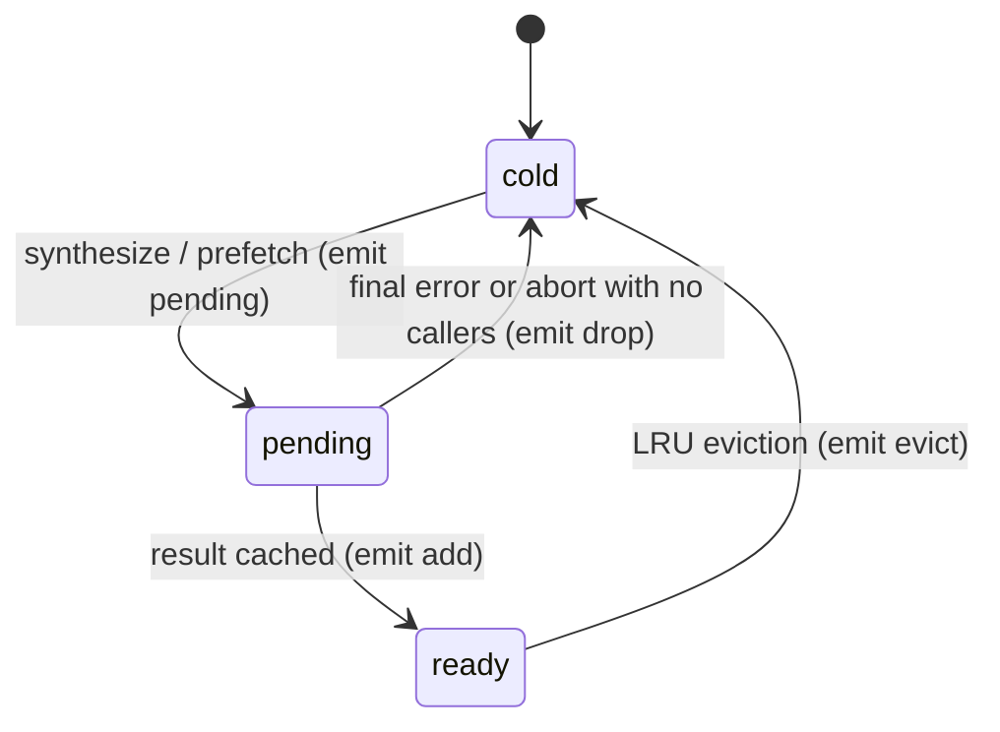

# Design: observable in-flight state

## Where it hooks in (`src/tts.ts`)

- `inFlight.set(r.key, flight)` → emit `{ type: "pending", key }`. A joining caller
  (`inFlight.get(r.key)` hit) emits nothing; a promotion emits nothing.
- Result path: `cache.set` already emits `add` through `LruCache`; the `inFlight.delete` that
  follows emits nothing (the key is now `ready`).
- Failure / abort path: the `inFlight.delete` that runs without a cached result emits
  `{ type: "drop", key }`. Retries inside `attempt` never touch `inFlight`, so nothing fires between
  attempts.
- `state(req)`: `cache.has(key) ? "ready" : inFlight.has(key) ? "pending" : "cold"`, wrapped in the
  same try/catch as `isCached` so an unknown voice answers `cold`.

Listeners are a single list: `tts.subscribe` wraps the cache's subscription and the new in-flight
emitter behind one unsubscribe. Event type widens to
`{ type: "pending" | "add" | "drop" | "evict"; key: string }` — a TypeScript consumer that
switched exhaustively on the old union gets a compile error, which is the point of the minor bump.

## Tests (`src/__tests__/tts.test.ts`)

- state: cold → pending on `synthesize` (before the fake engine resolves) → ready after; cold →
  pending → cold on engine failure; cold → pending → cold on abort of a queued job; unknown voice
  → cold without throwing.
- events: exact sequence `pending, add` for a success; `pending, drop` for a final failure;
  `pending` once when two callers join; no event between a transient failure and its retry;
  `evict` still emitted on LRU overflow.
- `isCached` unchanged (existing tests).

## Release

`chore: release 0.2.0` + tag `v0.2.0` → `release.yml` (trusted publishing). README gains
"Observing a request" under the quick start.
