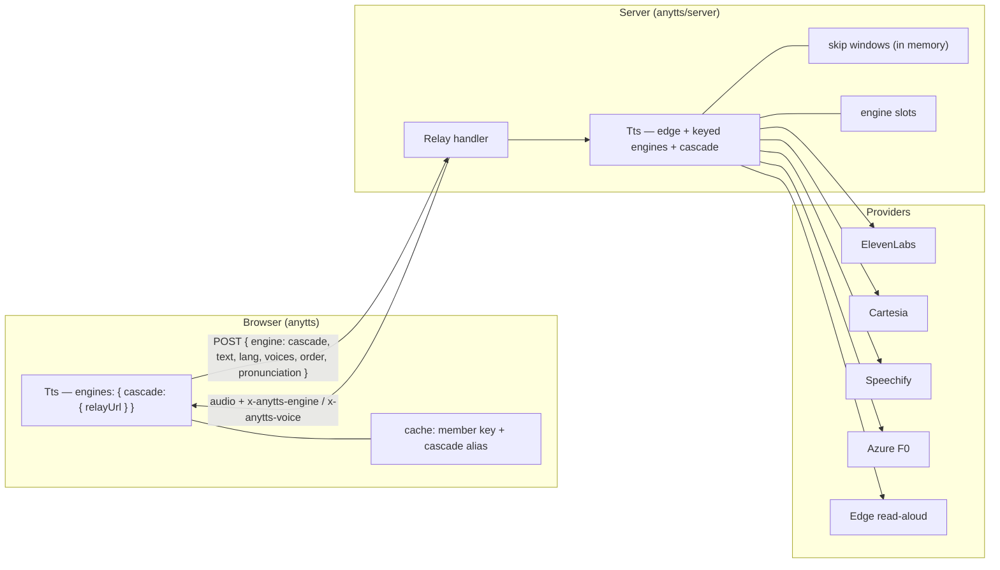
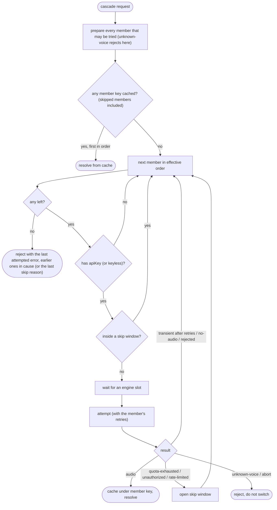

# Design: cascade-engine

## Glossary

- **Cascade** — the engine id `cascade`: one request tried on member engines in order until one speaks. _Avoid_: auto-free, auto, fallback chain, provider chain.
- **Member engine** — an engine listed in the cascade's `order`. _Avoid_: free engine, provider.
- **Keyed engine** — an engine that needs an `apiKey` and therefore runs only on the server. _Avoid_: paid engine, free engine.
- **Skip window** — the time a member is passed over after a quota, auth or rate-limit error. _Avoid_: cooldown, ban.
- **Engine slot** — one unit of an engine's `maxConcurrent`; a job holds one while its attempt runs. _Avoid_: lane, permit.
- **Cascade alias** — the browser-cache key (`cascade`, `lang`, options, text) that points at a member result. _Avoid_: virtual key.

## Overview



Keyed engines and the chain run where the keys are: in Node. The browser never holds a key; its
`cascade` and keyed engines are thin Relay clients.

## Configuration

```ts
createTts({
  defaultEngine: "cascade",
  engines: {
    elevenlabs: { apiKey: env.ELEVENLABS_API_KEY },                 // voices default per engine
    cartesia:   { apiKey: env.CARTESIA_API_KEY, maxConcurrent: 2 },
    speechify:  { apiKey: env.SPEECHIFY_API_KEY },
    azure:      { apiKey: env.AZURE_SPEECH_KEY, region: env.AZURE_SPEECH_REGION },
    edge:       { pronunciation: true },
    cascade:    { order: ["elevenlabs", "cartesia", "speechify", "azure", "edge"] },
  },
  pronunciation: { pl: { /* extra entries over the pl preset */ } },  // optional
  scheduler: { /* unchanged */ },
});
```

- **One shape for keyed engines:** `{ apiKey?, voices?, maxConcurrent?, pronunciation?, retries?,
  ...engine fields }`. Azure adds `region` (required when `apiKey` is set).
- **A member without `apiKey` is skipped**, never an error — so a consumer can list every member
  and let the keys decide. A keyed engine without `apiKey` used *directly* rejects `unauthorized`.
- **`cascade` validation at creation:** every `order` id must be a configured engine other than
  `cascade` (else `RangeError`); `cascade` has no `voices` (a `voices` entry is a `RangeError`).
- **Defaults:** each keyed engine ships a `pl`/`en`/`default` Voice map from its stock catalog;
  `pronunciation` defaults to `true` for `edge` and `false` for every other engine;
  `maxConcurrent` defaults to Azure 1, Cartesia 2, ElevenLabs 2, Speechify 2, Edge unlimited.
- **Catalogs:** `listEngines()` lists the keyed engines and `cascade` with `runtimes`
  (`["node"]` for keyed engines, `["browser", "node"]` for `cascade`), and `listVoices(id)` returns a
  static catalog of each provider's stock voices (`[]` for `cascade`).
- **Entry points:** the keyed engine factories are registered by `anytts/server` (its
  `createTts` re-export registers them); the main `anytts` entry registers only browser-safe
  factories — `edge` and the relay clients — so a browser bundle cannot contain key-handling code.

## Request shape

```ts
tts.synthesize({
  engine: "cascade",
  text, lang: "pl",
  voices?: { elevenlabs: "…", edge: "pl-PL-MarekNeural" },  // per member; else its Voice map by lang
  order?: ["azure", "edge"],                                // subset + order for this request
  pronunciation?: { edge: false },                          // per member override
});
```

- `voice` on a cascade request → `unknown-voice` (one voice id cannot name voices of several
  engines). `voices` / `order` / `pronunciation` on a non-cascade request are ignored.
- `order` entries that are not members are dropped; an empty effective order rejects with a
  `RangeError` (a caller bug, not a synthesis failure).
- Result: `{ bytes, mime, engine: <member id>, voice: <member voice> }`.

## The chain



- **Cache lookups first:** before any network work, the chain checks the member keys in effective
  order — skipped members included, since a skip reason only rules out requests — and the first
  cached one wins, so an already-synthesized unit never costs quota.
- **Waiting, not hopping:** a member whose slots are all taken is waited for (the job keeps its
  tier priority). Hopping would change the voice mid-answer for a momentary limit.
- **Final error:** the error of the last member actually attempted (a copy whose `cause` is the
  earlier attempts' errors, as an array in order, when there were any); if every member was skipped
  without an attempt, the skip reason of the last skipped member (e.g. `quota-exhausted`; a member
  without a key has kind `unauthorized` there, while `engineStatus` says `no-key`).
- **Abort** releases the slot and stops the chain.

### Error kinds and skip windows

| Kind | Raised when (per engine, confirmed against the provider in its task) | Skip window |
|---|---|---|
| `quota-exhausted` | the provider refuses because the period's characters/credits are used (402; Azure 403/429 with a "quota" message) | until 00:00 UTC on the 1st of next month |
| `unauthorized` | the key is missing, invalid or revoked | for the life of the instance |
| `rate-limited` | HTTP 429 (Azure F0 concurrency included), with `retryAfter` seconds from `Retry-After` | `retryAfter`, else 60 s |

`TtsError` gains `retryAfter?: number`. `quota-exhausted`, `unauthorized` and `rate-limited` are
**not** retried on the same engine (they are final for that engine, like `no-audio`). Skip windows
live in the instance; a restart costs at most one failed attempt per spent member. Rebuilding the
instance (a consumer replacing it after a key change) starts with no windows — wanted, since a new
key clears `unauthorized`.

**Observable state:** `tts.engineStatus(id)` returns `{ state: "ready" | "no-key" |
"quota-exhausted" | "rate-limited" | "unauthorized", until?: string /* ISO */ }` from the skip
windows, so a settings UI can show a live chip per member (the pavilio mockup does). The relay
does not expose it over HTTP; a consumer serves it from the same instance the relay uses (it
passes that instance as the relay's `tts`, see Relay protocol).

The exact status/body each provider returns for an exhausted quota is an open research point
(tts-providers wiki); each keyed engine's task pins it from the provider's docs and a recorded
fixture, and anything unrecognised maps to `rejected` (moves on, no window) — except a 5xx, which
is `network` (see Decisions during implementation).

## Pronunciation

- Applied by the library, after the member is picked: `applyPronunciation(text, lang,
  config.pronunciation)` when the member's effective `pronunciation` is on and `lang` is given.
- The member key is built on the **prepared** text, so Edge-with-map and ElevenLabs-without-map
  results never collide.
- This holds for single-engine requests too: an `edge` request with `pronunciation: true` now gets
  the `pl` preset applied by the library. Consumers that already apply it themselves turn the flag
  off or stop applying it (pavilio does the latter).

## Cache

- **Member key** — `(engine, voice, preparedText)`, as today for single engines.
- **Cascade alias** (browser only) — `(cascade, lang, optionsHash, text)`, where `optionsHash`
  covers `voices`, `order` and `pronunciation` — otherwise changing a member's voice would keep
  answering from the old audio. The alias points at the member entry; `state` / `isCached` on a
  cascade request read the alias; evicting the member entry evicts its aliases.
- The server does not keep aliases: its lookups walk the member keys (above).

## Relay protocol

- Body: `{ engine?, text, voice }` (one engine; `engine` defaults to `edge`, so today's clients are
  unchanged) or `{ engine: "cascade", text, lang?, voices?, order?, pronunciation? }`.
- `createRelayHandler(opts)` keeps `{ maxChars, authorize?, edge? }` and gains `tts?: TtsConfig | Tts`;
  with `tts`, the relay serves every engine of that config. Passing a `Tts` **instance** lets the
  consumer share it — read `engineStatus` from the instance whose skip windows the relay fills, and
  swap keys by building a new instance and a new handler (skip windows reset, which a new key
  wants anyway). Unknown `engine` → `400 { kind:
  "unknown-voice" }` (the engine/voice pair cannot be served). A cascade `order` that leaves no
  member → `400 { error }`.
- `200` responses carry `x-anytts-engine` and `x-anytts-voice` (the member that spoke).
- Errors: `502 { kind, retryAfter? }`; `rate-limited` also sets `Retry-After`.
- `authorize` stays optional (Q17): no check at creation; the README warns that a relay serving
  keyed engines without a guard spends the owner's quota.

## Browser relay clients

- `cascade` and each keyed engine accept only `{ relayUrl, firstByteMs?, stallMs? }` (cascade also `retries?`, default 0) in the browser and POST
  the request to it; `engine`/`voice` in the result come from the response headers.
- A cascade result is cached under the member key from the headers **and** the cascade alias.
- Relay errors keep their kind and `retryAfter`. Keyed relay clients follow the normal retry
  rules; the browser cascade defaults to `retries: 0` (a retry re-runs the relay's whole member
  walk), and its `firstByteMs` (default 20000) must cover the relay's worst-case walk.
- The relay sends `access-control-expose-headers: x-anytts-engine, x-anytts-voice, retry-after`
  on the `200` and the `502` with `Retry-After`, so cross-origin browsers can read them.

## Decisions during implementation

- **Cache before skip.** The walk looks up every member's key (skipped ones included) before the
  skip check, so a spent member's earlier results still answer (flowchart above).
- **Direct refusals open windows.** A `quota-exhausted` / `unauthorized` / `rate-limited` from a
  direct (non-cascade) request opens the engine's skip window too, so `engineStatus` reports it;
  the window steers the cascade only and never blocks direct requests.
- **Windows never shrink.** A later refusal does not shorten an open window or replace a longer
  one's kind.
- **Explicit `engine: "edge"` at the relay** goes through the shared `tts` instance (its cache,
  scheduler and pronunciation) when it configures `edge`; a body without `engine` stays on the
  standalone Edge engine.
- **402 → `quota-exhausted`:** ElevenLabs `payment_required` (plus 401 `quota_exceeded`),
  Speechify `payment_required`, and Cartesia's bare 402 (no `error_code`; `quota_exceeded` by code
  at any status).
- **5xx → `network`** (transient): a provider's own failure is retried and then cascades, instead
  of being final `rejected`.
- **Azure 403/429 with a "quota" message → `quota-exhausted`** (F0 monthly exhaustion); any other
  401/403 is `unauthorized`, a plain 429 `rate-limited`.
- **Empty effective cascade `order` → 400 at the relay** (`EmptyCascadeOrderError`, a
  `RangeError`), not a 502.
- **Final error carries the chain:** earlier attempts' errors sit on the final error's `cause` as an
  array.

## Testing

- Unit: chain walk with fake engines (skip on missing key, skip windows per kind, wait on a busy
  slot, cache-first lookup, final error rules, abort), alias cache, pronunciation placement.
- Per keyed engine: request shape and error classification against recorded fixtures; no live
  calls in CI.
- Relay: body variants, headers, error mapping, back-compat `{ text, voice }`.
- Optional manual live probe per provider with a real key (script, not CI).
