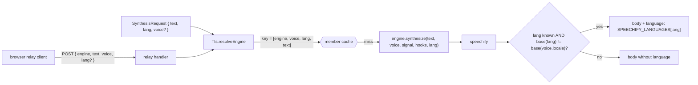

# Design: speechify-language

## Context

- Spike 2026-10-29 (18 live calls, `simba-3.5`, all `200`): `geffen_32` (en-US) without `language`
  reads Polish with English rules (7.00 s); with `pl` or `pl-PL` it speaks Polish with a US accent
  (5.18 s, identical bytes for both values). Native `kajetan` sounds right in every cell and its
  output does not depend on `language`. SSML `<lang xml:lang>` is stripped: the SSML cell equals the
  plain cell byte for byte.
- Docs (language-support, 2026-10-29): `language` is optional on `/v1/audio/stream`, format
  `pl-PL`; "when you omit `language`, the voice's own locale decides, so set it whenever the text is
  not in the voice's language".
- Live `GET /v1/voices`: native pl-PL stock voices are `dominika`, `iga`, `jagna`, `kajetan`,
  `michal`, `tymon`; the catalog lacks `dominika` and `michal`.

## Decisions

1. **Generic plumbing, one adopter (Q1).** `Engine.synthesize(text, voice, signal, hooks?, lang?)`.
   `lang` is the Request language exactly as the request gave it. Only Speechify reads it in this
   change; Cartesia/ElevenLabs can adopt it later without an interface change.
2. **Send `language` only across languages (Q2).** Speechify sends `language` when `lang` is known
   to the simba-3.5 table **and** its base subtag differs from the base of the voice's catalog
   locale. A same-language voice keeps its own locale, so an en-GB voice reading English stays en-GB.
3. **Locale table (Q2).** A fixed `SPEECHIFY_LANGUAGES` map, base code → locale, built from the
   docs' "Simba 3.5 languages" section. Where a base has several locales, the European variant
   wins: `en → en-GB` (Greg's preference), `pt → pt-PT`, `es → es-ES`. A `lang` with a region
   passes through unchanged when that locale is in the table; anything else sends no `language`.
4. **Direct relay carries `lang` (Q3).** `POST { engine?, text, voice, lang? }`, validated like the
   cascade body (string or absent, else `400`); browser relay clients send it when present.
5. **Cache key includes `lang` for every engine (Q4).** Member key
   `[engineId, voice, lang ?? null, preparedText]`. Engines that ignore `lang` pay at most one
   extra synthesis when the same text arrives with and without a language.

## Examples

| Voice (locale) | `lang` | Body `language` |
|---|---|---|
| `geffen_32` (en-US) | `pl` | `pl-PL` |
| `geffen_32` (en-US) | `pl-PL` | `pl-PL` |
| `hugh_32` (en-GB) | `en` | — |
| `kajetan` (pl-PL) | `pl` | — |
| `kajetan` (pl-PL) | `en` | `en-GB` |
| `geffen_32` (en-US) | `xx` | — |
| any | absent | — |

Exact body that worked in the spike:
`{ "input": "Dzień dobry. …", "voice_id": "geffen_32", "model": "simba-3.5", "language": "pl-PL" }`.

## Error handling

No new error kinds. An unknown or unmappable `lang` never reaches the provider, so it cannot cause
a `400`. A non-string `lang` on a direct relay request is a `400` with the expected body shape in
the message, as the cascade body already does.

## Testing

- `speechify > sends language pl-PL for a pl request on an en-US voice`
- `speechify > sends a region-qualified lang from the table unchanged`
- `speechify > maps en to en-GB`
- `speechify > omits language when the voice already speaks the request language`
- `speechify > omits language when the request has no lang`
- `speechify > omits language for a lang outside the simba-3.5 table`
- `voices > speechify catalog lists all six native pl-PL voices`
- `tts > passes req.lang to engine.synthesize on the direct path`
- `tts > passes req.lang to each cascade member's synthesize`
- `tts > the same text with different lang does not share a cache entry`
- `relay > forwards lang on a direct request`
- `relay > rejects a non-string lang on a direct request`
- `relay client > sends lang on a direct keyed request when the request has one`

## Glossary

- **Request language** — The language a synthesis request names (`lang`, a Voice map key such as `pl`, optionally region-qualified), handed to the engine alongside the chosen Voice (avoid: locale, input language).
- **Voice** — A named speaker belonging to exactly one Engine, with a fixed locale or marked multilingual; an Engine offers many Voices, and exactly one is chosen per request, by explicit pin or Voice map (avoid: speaker, model).
