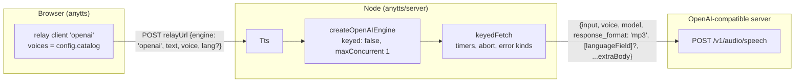

# Design: openai-compatible-engine

## Context

- An engine's config key in `TtsConfig.engines` is also its factory id (`src/tts.ts:262-267`).
  Cascade `order`, the cache key and the "one voice id, one engine" rule all go by that id.
- Before every request, `tts.ts:343` checks the voice against `engine.voices`, which is fixed at
  construction time.
- `keyedFetch` (`src/engines/keyed.ts`) already handles the first-byte and stall timers, aborts,
  `Retry-After`, and the mapping of statuses to error kinds.
- The cascade skips an engine without a request only when `keyed === true` and it has no `apiKey`
  (`tts.ts:419`).
- In the browser, relay clients exist only for the ids in the static `CATALOGS`
  (`relayEngine.ts:209`).

## Architecture



## Engine options

```ts
export interface OpenAIEngineOptions {
  /** Server root, e.g. "http://127.0.0.1:8890"; the engine appends "/v1/audio/speech". Required. */
  baseUrl: string;
  /** The voices this server offers; replaces a static catalog. Required, non-empty. */
  catalog: VoiceInfo[];
  /** Sent as `Authorization: Bearer` only when set. */
  apiKey?: string;
  /** Default "tts-1". */
  model?: string;
  /** Body field that carries the request language (OmniVoice: "language"); unset → never sent. */
  languageField?: string;
  /** Merged into every request body; cannot override input/voice/model/response_format. */
  extraBody?: Record<string, unknown>;
  firstByteMs?: number; // default 15000
  stallMs?: number;     // default 8000 (keyedFetch)
  fetch?: typeof fetch;
}
```

- **Request body.** The body is `{ ...extraBody, input, voice, model, response_format: "mp3" }`.
  The fixed fields come last, so `extraBody` can't override them. When it applies, the language
  field is added after that.
- **Language rule.** The base of `lang` is everything before the first `-`, lowercased. It is
  sent only when `languageField` is set and that base differs from the base of the voice's
  `catalog` locale. A voice id not in `catalog` can't get here, because `tts.ts:343` rejects it
  first.
- **Errors.** All errors come from `keyedFetch`. A refused connection or DNS failure gives
  `network`, and so does a 5xx. 401 gives `unauthorized`, 429 gives `rate-limited` (with
  `Retry-After`), and any other 4xx gives `rejected`. `isQuota` is always false: a self-hosted
  server has no quota.
- **Construction checks.** These throw `RangeError` when `createTts` runs:
  - `baseUrl` is missing, empty or not an `http(s)` URL
  - `catalog` is missing or empty
  - a `catalog` entry has a duplicate id
  - `voices.default`, or any value in the voice map, is not in `catalog`
- **Where it's registered.** `anytts/server` registers the engine, next to the keyed engines
  (`KEYED_ENGINES` → renamed `NODE_ENGINES` internally; its export name is unchanged). It
  isn't added to the browser-safe factories.
- **Voice map default.** There is none: `defaults.voices` is `{ default: catalog[0].id }`, so an
  app that sets no `voices` still gets a valid map.

## Browser relay client

`RELAY_ENGINES` gains `openai`. Its options are the existing relay options plus `catalog`
(required), so the browser can check voices locally just as it does for keyed engines.
`apiKey`, `baseUrl` and `extraBody` aren't allowed in the browser: each one throws a
`RangeError`, matching the existing rule that no key reaches the browser.

## Registry

`ENGINES` gains `{ id: "openai", label: "OpenAI-compatible (custom server)", runtimes: ["node"] }`
with `voices: []`. `listVoices("openai")` therefore returns `[]`, and apps read their own catalog.

## Testing

All tests use an injected `fetch` fake, like the Speechify tests. They cover:
- the body shape
- the language sent only when it differs, and never without `languageField`
- `extraBody` merged but unable to override the fixed fields
- Bearer only with `apiKey`
- the URL joined without a double slash
- error mapping (refused connection → `network`, 400 → `rejected`)
- construction errors
- `maxConcurrent` defaulting to 1
- the cascade not skipping `openai` without a key
- the relay client accepting a catalog voice and rejecting one outside it
- `listEngines` and `listVoices`

## Glossary

- **OpenAI-compatible engine** — The engine id `openai`: one app-configured server that speaks OpenAI's `POST /v1/audio/speech`, with its voices supplied by the app (avoid: OmniVoice engine, local engine, custom provider).
- **App catalog** — The list of Voices an app passes in an engine's config, which replaces the library's static catalog for that engine wherever voices are listed or checked (avoid: dynamic catalog, voice list).
