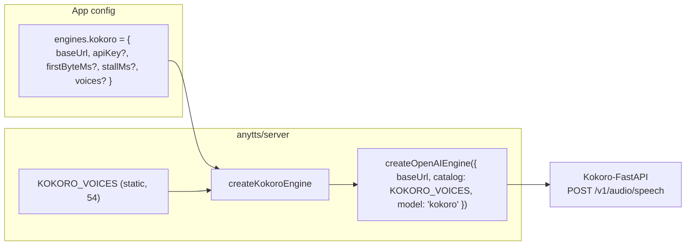

# Design: kokoro-engine

## Shape

`kokoro` is a factory in `src/engines/kokoro/` that builds an `openai` engine with fixed options:

- `catalog`, `model`, `languageField` and `extraBody` are not accepted from the app. Passing
  any of them throws `RangeError`, because the engine owns those fields.
- `defaults.voices` is `{ default: "af_heart" }`, not the `openai` default of the first catalog
  voice. `maxConcurrent` stays 1.
- `firstByteMs` defaults to 30000, double the `openai` default, to cover a cold model load.
- Errors: same classification as `openai` (network / unauthorized / rate-limited / rejected).

## Catalog

The source is Kokoro-82M v1.0's `VOICES.md`. The id prefix encodes language and gender:

| Prefix | Locale | Voices |
|---|---|---|
| `a` | en-US | af_heart, af_alloy, af_aoede, af_bella, af_jessica, af_kore, af_nicole, af_nova, af_river, af_sarah, af_sky, am_adam, am_echo, am_eric, am_fenrir, am_liam, am_michael, am_onyx, am_puck, am_santa |
| `b` | en-GB | bf_alice, bf_emma, bf_isabella, bf_lily, bm_daniel, bm_fable, bm_george, bm_lewis |
| `e` | es-ES | ef_dora, em_alex, em_santa |
| `f` | fr-FR | ff_siwis |
| `h` | hi-IN | hf_alpha, hf_beta, hm_omega, hm_psi |
| `i` | it-IT | if_sara, im_nicola |
| `j` | ja-JP | jf_alpha, jf_gongitsune, jf_nezumi, jf_tebukuro, jm_kumo |
| `p` | pt-BR | pf_dora, pm_alex, pm_santa |
| `z` | zh-CN | zf_xiaobei, zf_xiaoni, zf_xiaoxiao, zf_xiaoyi, zm_yunjian, zm_yunxi, zm_yunxia, zm_yunyang |

The second letter `f`/`m` gives the gender. The label is the capitalised name after `_` (`af_heart`
→ `Heart`). `multilingual` is `false` for every voice. The catalog is written out as data
(`voices.ts`), not derived at runtime. A test checks that every id's locale and gender match its
prefix.

## Language

`languageField` is unset, so the request language is never sent. A Polish request to `af_heart` is
read with the English phonemizer. This is deliberate (see proposal § Out of scope).

## Browser

The browser relay-client branch accepts `kokoro` like `openai`, but takes its catalog from
`KOKORO_VOICES` instead of a required `catalog` option. `catalog`, `baseUrl` and `apiKey` in the
browser throw `RangeError`.

## Testing

- Factory: request URL/body (`model: "kokoro"`, no language field), apiKey header, default voice,
  forbidden options, and the 30 s default first byte.
- Catalog: 54 unique ids, locale and gender consistent with the prefix, `af_heart` present.
- Registry: `listEngines` entry; `listVoices("kokoro")` returns copies of the catalog.
- Relay client: a browser `kokoro` request reaches the relay; a voice outside the catalog rejects
  `unknown-voice` without a call.
